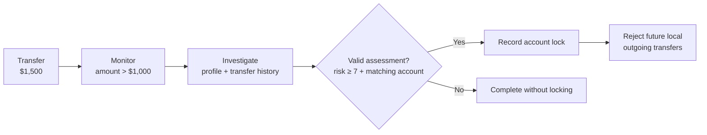
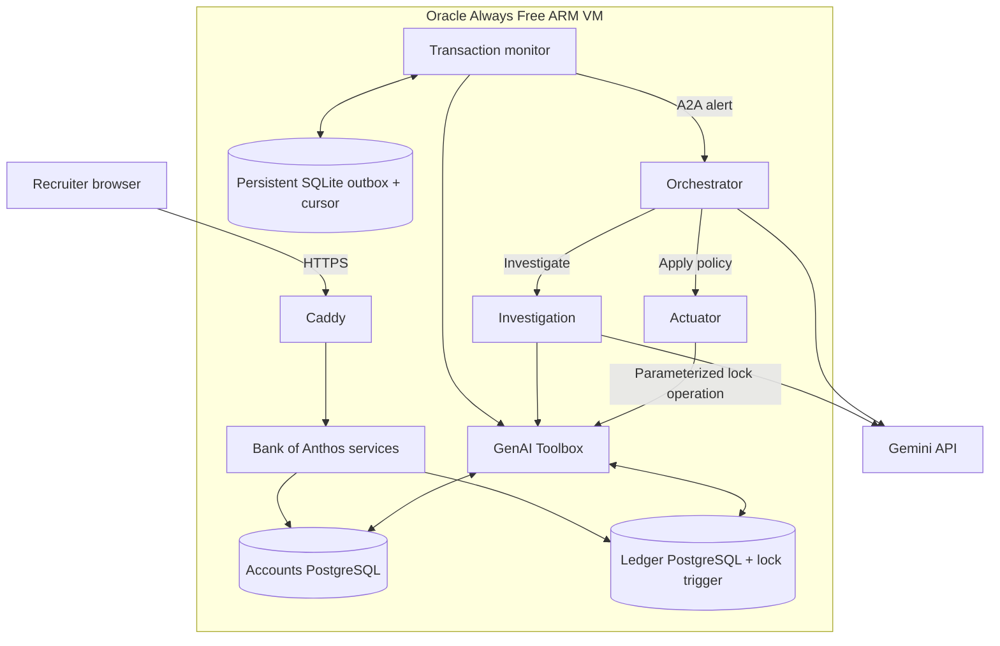
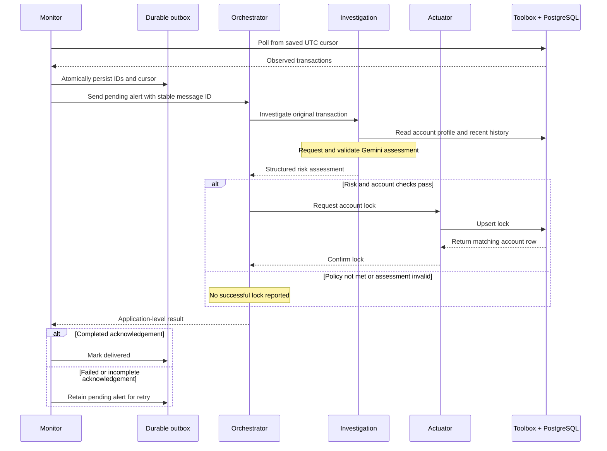
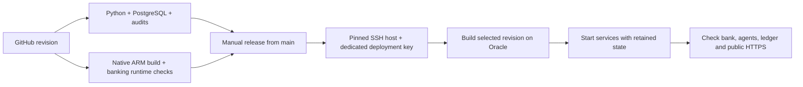
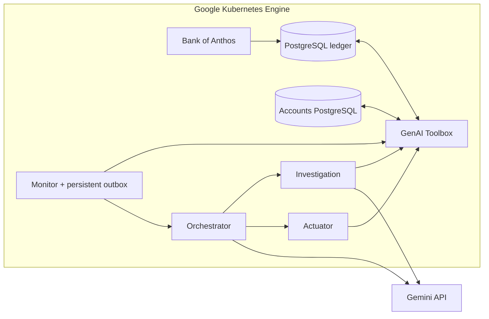

# Vigil

### From a suspicious transfer to an enforceable decision

A Python AI-agent workflow that monitors a banking demo, investigates unusual
transfers, and blocks future outgoing payments when its risk policy is met.

**[Open the live demo →](https://vigil-161-118-164-31.sslip.io/login)** ·
[Cloud verification](docs/ORACLE_VERIFICATION.md) ·
[Engineering contributions](PORTFOLIO.md) ·
[Deployment guide](deploy/oracle/README.md)

[](https://github.com/dgexplores/vigil/actions/workflows/ci.yml)
[](https://github.com/dgexplores/vigil/actions/workflows/oracle-deploy.yml)

Maintained by [dgexplores](https://github.com/dgexplores), extending the
[original Vigil project](https://github.com/ayanliger/gke-turns10-hackathon-vigil)
and Google's Bank of Anthos. Upstream authorship is retained.

## Try the live demo

| | Details |
|---|---|
| **Deployed application** | **[vigil-161-118-164-31.sslip.io](https://vigil-161-118-164-31.sslip.io/login)** |
| **Demo username** | `testuser` |
| **Demo password** | `bankofanthos` |
| **Hosting** | Oracle Always Free ARM VM · Docker Compose · Caddy HTTPS |
| **AI model** | Gemini 3.5 Flash-Lite · project billing disabled |

1. Sign in to explore the fictional balance, contacts, and transaction history.
2. Small payments exercise the banking routes. Transfers above **$1,000** enter
   Vigil's background review; a high risk assessment can lock the sender.
3. Read the [verified cloud walkthrough](docs/ORACLE_VERIFICATION.md) to see how
   an alert became an investigation, a database lock, and a rejected later transfer.

The public page is the banking interface. Investigation and action happen in
private background services; there is no separate public AI chat or agent API.
**Use fictional data only.** This is a portfolio demonstration, not an actual bank.
Free hosting capacity and model quotas can affect availability.

## The story: why one transfer needs a workflow

A customer sends **$1,500**. The amount alone does not establish fraud. An
operations analyst needs the account's history, an assessment of the unusual
activity, and a reliable way to apply the resulting decision.

Vigil connects those steps. The monitor observes the transfer, the investigation
agent gathers context, and the orchestrator coordinates the response. When the
risk score meets policy and the account identity matches, the actuator records
an account lock in PostgreSQL. A trigger rejects later outgoing transfers from
that local account.



The live synthetic checks exercised this path and confirmed the database lock.
They do **not** establish fraud accuracy. A lock neither reverses the initial
transfer nor disables the customer's login. Amounts are stored in **integer
cents**: `$1,500 = 150000` and the deployed alert threshold is `100000` cents.

## Architecture of the live application



Only Caddy exposes public application ports. The databases, Toolbox, and agent
APIs remain on the private container network. Separate volumes retain account
data, transactions, monitor delivery state, and certificates across restarts.
This is a single-host deployment; it does not provide high availability.

| Component | Responsibility | Source |
|---|---|---|
| **Monitor** | Poll transactions, persist alerts, deduplicate IDs, retry delivery | [Monitor](vigil-system/transaction_monitor_agent/agent.py), [outbox](vigil-system/transaction_monitor_agent/delivery_store.py) |
| **Orchestrator** | Coordinate agents and enforce risk/account policy | [Agent](vigil-system/orchestrator_agent/agent.py) |
| **Investigation** | Retrieve context and validate Gemini's structured assessment | [Agent](vigil-system/investigation_agent/agent.py) |
| **Actuator** | Apply a lock and require a matching database result | [Agent](vigil-system/actuator_agent/agent.py) |
| **Toolbox** | Expose parameterized profile, history, transaction and lock queries | [SQL tools](vigil-system/genal_toolbox/tools.yaml) |
| **Ledger guard** | Enforce account locks when outgoing transactions are inserted | [Migration](vigil-system/genal_toolbox/migrations/001_account_locks.sql) |

**Technology:** Python 3.11 · FastAPI · asyncio · HTTPX · Google ADK · A2A SDK ·
Gemini · PostgreSQL · SQLite · Docker · Caddy · Kubernetes manifests · GitHub Actions.

<details>
<summary><strong>Follow the complete message and acknowledgement sequence</strong></summary>



</details>

## Engineering work in this extension

| Operational problem | Implemented change |
|---|---|
| A restart loses undelivered alerts | Durable SQLite cursor and outbox on a persistent volume |
| Polling advances before an alert succeeds | Retry pending alerts independently of later polls |
| Repeated polls or equal timestamps repeat/miss transfers | Inclusive UTC boundary, ID deduplication, stable message IDs |
| Concurrent investigations mix context | Request-scoped orchestration state |
| A model proposes the wrong account or an action below threshold | Deterministic account, finite-score, and policy checks |
| A service reports a lock without changing the database | Require the matching returned account row and enforce a ledger trigger |
| ARM packaging and database restarts expose upstream assumptions | Native source builds, corrected Java entry point, stable hostnames, connection pre-ping |
| A deployment loses state or exposes internal services | Persistent volumes, private service ports, generated credentials, verified CI/CD |

Delivery is **at least once**. A crash between a remote action and its
acknowledgement can repeat that action; the lock upsert is idempotent. There is
no distributed exactly-once claim. See [contributions](PORTFOLIO.md) and
[reconstruction notes](docs/RECONSTRUCTION.md) for scope and provenance.

## Verified results

| Check | Recorded evidence |
|---|---|
| **Live HTTPS and banking routes** | Browser login, balance, contacts and transaction history worked |
| **Live AI workflow** | Two synthetic alerts completed investigation and database-confirmed locking |
| **Actual enforcement** | PostgreSQL rejected a later outgoing transfer from a locked sender |
| **Restart recovery** | Retained 62 transactions, two locks, and two delivered outbox records; first login after restart passed |
| **Cloud delivery** | [All CI jobs and automated Oracle rollout passed](https://github.com/dgexplores/vigil/actions/runs/40063802734) |
| **Regression coverage** | Offline Python checks, packaged monitor checks, and a separate real PostgreSQL contract job |

The checks use synthetic data and do not measure production fraud precision,
recall, throughput, or high availability. Detailed dates, revisions, test counts,
and limitations are in [Oracle verification](docs/ORACLE_VERIFICATION.md),
[local verification](docs/LOCAL_VERIFICATION.md), and [service evidence](docs/SERVICE_EVIDENCE.md).

## Project structure

```text
vigil/
├── bank-of-anthos/                 # Pinned, attributed banking submodule
├── vigil-system/
│   ├── transaction_monitor_agent/  # Polling, durable cursor and outbox
│   ├── orchestrator_agent/         # Coordination and deterministic policy
│   ├── investigation_agent/        # Context retrieval and Gemini assessment
│   ├── actuator_agent/             # Database-confirmed account locks
│   └── genal_toolbox/              # SQL tools and ledger migration
├── deploy/oracle/                 # ARM builds, configuration, release and checks
├── tests/                         # Delivery, service and database contracts
├── scripts/                       # Integration verification helpers
├── .github/workflows/
│   ├── ci.yml                     # Python, PostgreSQL, audits and image builds
│   ├── oracle-arm.yml             # Native ARM banking runtime verification
│   ├── oracle-deploy.yml          # Verified deployment to the existing Oracle VM
│   └── deploy.yml                 # Original GKE rollout through GitHub OIDC
├── docs/                          # Architecture, evidence and operator guides
└── PORTFOLIO.md                    # Contributions and role alignment
```

## Run the checks locally

```bash
git clone --recurse-submodules https://github.com/dgexplores/vigil.git
cd vigil
make install
make test
```

Use Python 3.11, Make and Git; Docker is needed for container and real database
checks. `make install` creates separate ADK and monitor environments because
their pinned dependencies must not be combined. The PostgreSQL contract is
skipped unless `TEST_POSTGRES_DSN` points to a disposable test database.
Offline tests do not need a Gemini key. Follow [local setup](docs/LOCAL_VERIFICATION.md)
and the [Oracle deployment guide](deploy/oracle/README.md) for complete commands.

## CI/CD and deployment



The Oracle workflow deploys to an existing host, keeps secrets outside Git,
preserves named volumes, and waits for real service checks. It does not create
paid cloud resources or provide an automatic database rollback. Configuration
and recovery instructions are in the [deployment guide](deploy/oracle/README.md).

<details>
<summary><strong>Original GKE architecture and deployment option</strong></summary>

The original Kubernetes manifests remain available. This adaptation's verified
live deployment is Oracle; no GKE rollout is claimed.



`deploy.yml` uses repository-scoped OIDC to update an existing GKE deployment.
Its GCP deployment gate remains disabled. GKE compute cannot be promised free;
see [GKE readiness](docs/DEPLOYMENT_READINESS.md) and [CI/CD details](docs/CI_CD.md).

</details>

<details>
<summary><strong>Internal endpoints and operator settings</strong></summary>

| Service | Routes | Container port |
|---|---|---|
| Orchestrator | `POST /`, `POST /a2a/send-message`, `GET /health` | 8000 |
| Investigation | A2A routes, `POST /investigate`, `GET /health` | 8000 |
| Actuator | A2A routes, `POST /execute`, `GET /health` | 8000 |
| Toolbox | Parameterized tools in `tools.yaml` | 5000 |

These routes are internal and must stay private. The monitor is a background
worker. An uninitialized agent returns 503 from its health endpoint.

| Setting | Oracle demo configuration |
|---|---|
| `FRAUD_THRESHOLD` | `100000` cents ($1,000); the inherited `1000` default means $10 |
| `POLL_INTERVAL` | 15 seconds |
| `RISK_SCORE_THRESHOLD` | 7 |
| `GEMINI_MODEL` | `gemini-3.5-flash-lite` |
| `GEMINI_API_KEY` | Runtime credential outside Git |
| `MONITOR_STATE_PATH` | `/data/monitor.sqlite3` on a persistent volume |
| `MONITOR_START_TIMESTAMP` | Preserved initial UTC boundary for new monitor state |

</details>

## Scope and attribution

This project demonstrates Python application development, REST/A2A integration,
SQL contracts, automation, debugging, model-output validation, containers, and
CI/CD. It is an extension of open-source work, not a claim of original upstream authorship.

The ledger guard targets local routing number `883745000`. Late-arriving data,
unbounded retention, scaling, and production recovery remain documented limits.
An upstream OpenTelemetry advisory remains constrained by Google ADK; remote
trace propagation is disabled and regression-tested as mitigation. See
[dependency review](docs/DEPENDENCY_REVIEW.md).

Built on [Vigil and its contributors](https://github.com/ayanliger/gke-turns10-hackathon-vigil)
and [Google Bank of Anthos](https://github.com/GoogleCloudPlatform/bank-of-anthos).
Upstream hackathon participation and recognition belong to their original authors.
The [MIT license](LICENSE), individual file/submodule notices, and
[publication record](PUBLICATION.md) retain provenance.
