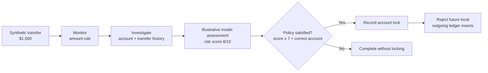
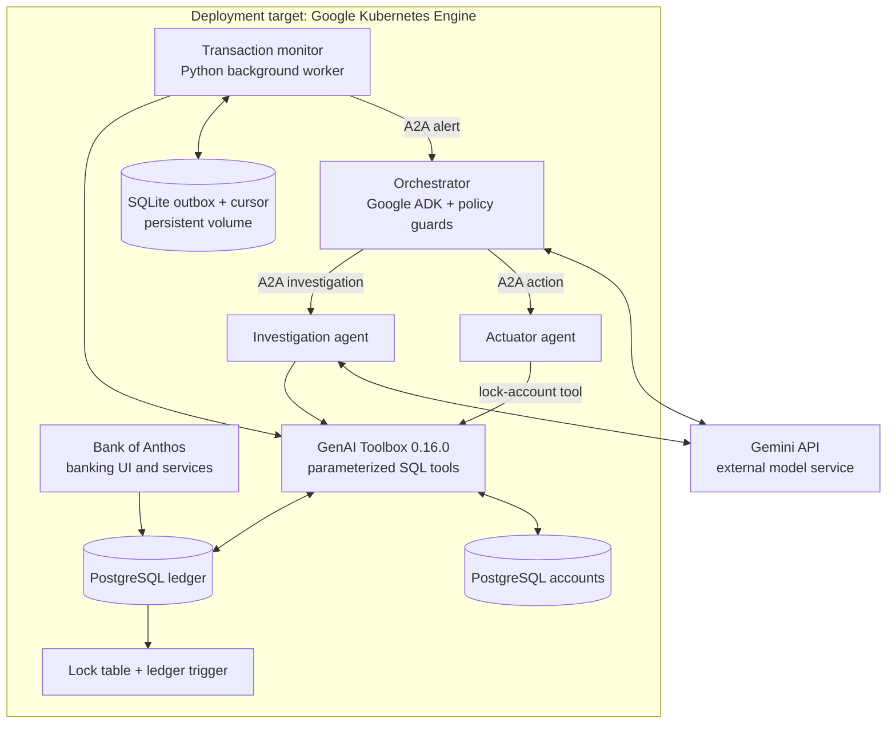
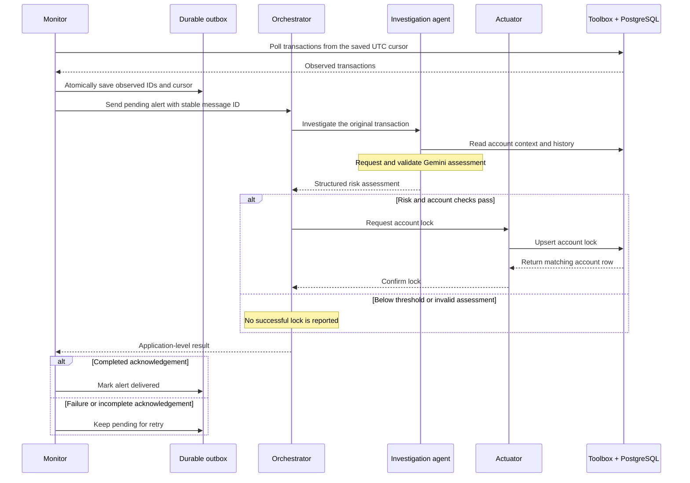
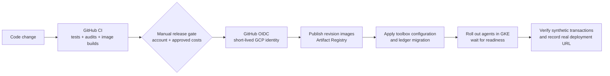

# Vigil — From a suspicious transfer to an enforceable decision

[](https://github.com/dgexplores/vigil/actions/workflows/ci.yml)

**A Python AI-agent workflow that monitors a banking demo, investigates flagged transfers, and can block future outgoing payments from a risky account.**

Maintained by [dgexplores](https://github.com/dgexplores). This is an engineering extension of the [original Vigil project](https://github.com/ayanliger/gke-turns10-hackathon-vigil), with upstream authorship and notices retained.

> **Deployment status:** the application is verified locally and its full GitHub CI has passed. The GKE backend and live Gemini inference are not deployed or verified in this adaptation. No live banking/AI application URL is claimed here. See [deployment readiness](docs/DEPLOYMENT_READINESS.md).

[Read the source](https://github.com/dgexplores/vigil) · [See the successful CI run](https://github.com/dgexplores/vigil/actions/runs/39825812137) · [Review the engineering contributions](PORTFOLIO.md)

## The story: one transfer, several unanswered questions

Imagine a fictional customer sending **$1,500**. The amount alone does not prove fraud. An operations analyst still needs to know: Is this unusual for the account? What happened before it? What should happen next?

Vigil connects those steps into one workflow. A monitor notices the transfer, an investigation agent gathers context, and an orchestrator coordinates the decision. If the risk meets a configured policy, an actuator records an account lock in PostgreSQL. A database trigger then rejects future outgoing transfers from that local account.

The interesting engineering problem is what happens between those steps: a service can fail, a worker can restart, an alert can be retried, or an LLM can return an invalid answer. This extension focuses on making those boundaries explicit and testable.

The example below is illustrative, not a live fraud result. Bank of Anthos stores money in **integer cents**: `$1,500 = 150000`. To flag amounts above `$1,000`, configure `FRAUD_THRESHOLD=100000`; the inherited default of `1000` means **$10**, not $1,000.



A lock does **not** reverse the original transfer or disable the customer's login. The initial amount rule is not a trained fraud classifier, and the model's fraud accuracy has not been measured here.

## Architecture: how the pieces talk

The deployment target remains **Google Kubernetes Engine**, with Bank of Anthos as the banking demonstration application. The agents are separate Python services; the database toolbox is an upstream Go component.



| Component | Its job | Where to read |
|---|---|---|
| Transaction monitor | Poll transfers, apply the amount rule, persist pending alerts, retry delivery | [`agent.py`](vigil-system/transaction_monitor_agent/agent.py), [`delivery_store.py`](vigil-system/transaction_monitor_agent/delivery_store.py) |
| Orchestrator | Coordinate investigation and action while enforcing deterministic account/risk checks | [`agent.py`](vigil-system/orchestrator_agent/agent.py) |
| Investigation agent | Fetch context and validate the model's structured risk assessment | [`agent.py`](vigil-system/investigation_agent/agent.py) |
| Actuator | Request a lock and require a matching database result before reporting success | [`agent.py`](vigil-system/actuator_agent/agent.py) |
| Database toolbox | Expose parameterized transaction, profile, history, and lock operations | [`tools.yaml`](vigil-system/genal_toolbox/tools.yaml) |
| Ledger migration | Store locks and reject future outgoing transfers from locked local accounts | [`001_account_locks.sql`](vigil-system/genal_toolbox/migrations/001_account_locks.sql) |

**Stack:** Python 3.11, asyncio, FastAPI, HTTPX, Google ADK, A2A SDK, Gemini, PostgreSQL, SQLite, Docker, Kubernetes, and GitHub Actions.

## Follow a transaction through the system



The model contributes an assessment. The code checks finite risk scores, the configured threshold, and the original account identity before allowing actuation. A failed investigation or lock operation is reported as a failure rather than a successful outcome.

## What this extension improves

| Failure an operations team would notice | Engineering change |
|---|---|
| A worker restarts and forgets undelivered alerts | Persist the cursor and outbox in SQLite on a mounted volume |
| An alert fails after polling has advanced | Retry pending alerts independently of the next successful poll |
| The same transfer appears in repeated polls | Deduplicate observed transaction IDs and reuse a stable alert ID |
| Two transfers share a timestamp | Use an inclusive UTC polling boundary plus ID deduplication |
| Parallel investigations mix their context | Keep orchestration state isolated per request |
| A model proposes locking the wrong account or acts below policy | Check the original account and risk threshold deterministically |
| A service says “locked” without confirming a database change | Require the matching returned database row |
| A lock is only a label in application memory | Enforce it with an additive PostgreSQL table and ledger trigger |

These changes provide **at-least-once delivery**, not distributed exactly-once execution. A crash between a remote action and its acknowledgement can repeat an action; the lock upsert is idempotent. Older late-arriving rows, unbounded retention, and large polling batches remain documented limits.

## Project structure

```text
vigil/
├── bank-of-anthos/                 # Attributed, pinned Google banking submodule
├── vigil-system/
│   ├── transaction_monitor_agent/  # Polling, durable outbox, persistent volume
│   ├── orchestrator_agent/         # A2A coordination and policy checks
│   ├── investigation_agent/        # Context retrieval and Gemini assessment
│   ├── actuator_agent/             # Database-confirmed account locking
│   └── genal_toolbox/              # SQL tools, pinned image, ledger migration
├── tests/                         # Delivery, service, tracing and database contracts
├── scripts/                       # Synthetic toolbox verification helper
├── .github/workflows/
│   ├── ci.yml                     # Tests, audits, five image builds
│   └── deploy.yml                 # Manually gated GKE rollout through OIDC
├── docs/                          # Architecture evidence, setup and release limits
├── Makefile                       # Install and verify local environments
└── PORTFOLIO.md                    # Contribution record and role alignment
```

## Evidence: what has actually been checked

| Check | Verified result | What it does not establish |
|---|---|---|
| Service and database suite | **25 tests passed with real PostgreSQL 17** | Live Gemini quality or deployed GKE behavior |
| Monitor's own environment | **13 monitor tests passed**, also inside its packaged container | Exactly-once remote execution |
| GitHub Actions | [Full CI passed](https://github.com/dgexplores/vigil/actions/runs/39825812137): Python, database contract, audit, and all five image builds | A successful cloud rollout |
| Actual local integrations | Toolbox HTTP tools and actuator-to-toolbox-to-PostgreSQL locking passed with synthetic data | Real customer banking controls |
| Publication scan | Full publication history had no detected leaks in the recorded Gitleaks scan | Absence of unknown secrets or vulnerabilities |

The 13 monitor checks are a repeated verification of that component in its own runtime, **not 13 additional distinct features or a separate accuracy benchmark**. See [local verification](docs/LOCAL_VERIFICATION.md), [service evidence](docs/SERVICE_EVIDENCE.md), and the [reconstruction ledger](docs/RECONSTRUCTION.md).

## Try the verified checks locally

Install Python 3.11, Make, and Git. Docker is needed for the optional real PostgreSQL checks and image builds.

```bash
git clone --recurse-submodules https://github.com/dgexplores/vigil.git
cd vigil
make install
make test
```

`make install` creates two isolated environments: `.venv` for the shared ADK services and `.monitor-venv` for the monitor. Their pinned dependency sets must not be combined into one pip install.

Without `TEST_POSTGRES_DSN`, the real-database contract is explicitly skipped. To reproduce the full database result, follow the disposable PostgreSQL instructions in [LOCAL_VERIFICATION.md](docs/LOCAL_VERIFICATION.md). Offline checks do not require a Gemini key and do not call Google Cloud.

## Endpoints and operator configuration

The banking UI belongs to Bank of Anthos. Vigil's APIs are internal service contracts; the monitor is a background worker.

| Service | Routes | Container port |
|---|---|---|
| Orchestrator | `POST /`, `POST /a2a/send-message`, `GET /health` | 8000 |
| Investigation | A2A routes, `POST /investigate`, `GET /health` | 8000 |
| Actuator | A2A routes, `POST /execute`, `GET /health` | 8000 |
| Toolbox | Parameterized SQL tools described in `tools.yaml` | 5000 |

Kubernetes services map their public service port to the container port; the supplied toolbox and agent services use internal port 80. An uninitialized agent returns 503 from its health endpoint. Keep these services private to the cluster; they are not public-user authentication endpoints.

| Setting | Meaning |
|---|---|
| `FRAUD_THRESHOLD` | Initial amount rule in cents; inherited default `1000.0` is $10 |
| `POLL_INTERVAL` | Polling interval; default 5 seconds |
| `RISK_SCORE_THRESHOLD` | Minimum risk score for policy evaluation; default 7 |
| `GEMINI_API_KEY` | Your own model credential, supplied outside Git |
| `MONITOR_STATE_PATH` | Outbox/cursor file; `/data/monitor.sqlite3` in Kubernetes |
| `MONITOR_START_TIMESTAMP` | Initial UTC lower bound for a new state database |

## Deployment: prepared, with a clear release boundary



The deployment workflow updates an existing cluster; it does not provision GKE or the banking application. Configure the account, registry, databases, secrets, persistent storage, and repository-scoped OIDC identity first. Apply the ledger migration before starting enforcement, and run one monitor replica with the supplied volume.

**Current budget: ₹0.** `CLOUD_DEPLOYMENT_ENABLED` remains disabled. GKE's free allowance does not cover the application's compute, so the original architecture cannot be promised free. [Google's GKE pricing](https://cloud.google.com/kubernetes-engine/pricing) is the authority for current charges.

Follow [DEPLOYMENT_READINESS.md](docs/DEPLOYMENT_READINESS.md) and [CI_CD.md](docs/CI_CD.md) for configuration, rollout order, verification, and rollback. A real application link belongs here only after that deployed revision has been tested.

## Remaining engineering boundaries

- Live Gemini inference, full GKE operation, fraud precision/recall, throughput, and recovery under production load have not been measured.
- Delivery is at least once, with the late-arrival, retention, and scaling limits described above.
- The ledger trigger targets local routing number `883745000`; it does not reverse settled transfers or disable login.
- Google ADK constrains one upstream OpenTelemetry dependency below its patched release. Incoming trace propagation is forcibly disabled and regression-tested as mitigation; the dependency advisory itself is not fixed. See [DEPENDENCY_REVIEW.md](docs/DEPENDENCY_REVIEW.md).
- This is a synthetic-data portfolio application, not a certified banking or fraud-prevention system.

## Why this project is relevant to a Python / AI operations role

It connects Python application development with REST and A2A service integration, SQL/database contracts, automation, debugging, AI-output validation, container packaging, Git, technical documentation, and CI/CD. The contribution record describes concrete extensions rather than claiming the upstream product as entirely new work.

## Attribution and licensing

Built on [Vigil by ayanliger and its contributors](https://github.com/ayanliger/gke-turns10-hackathon-vigil) and Google's [Bank of Anthos](https://github.com/GoogleCloudPlatform/bank-of-anthos). Upstream hackathon participation, recognition, and deployments belong to their original authors.

The repository includes an [MIT license](LICENSE); individual files and the banking submodule retain their own notices. [PUBLICATION.md](PUBLICATION.md) explains the credential-sanitized public history. [PORTFOLIO.md](PORTFOLIO.md) records the engineering work in this extension.
