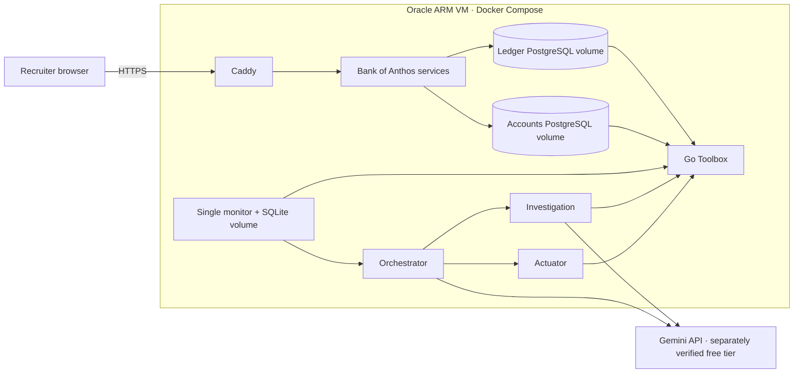

# Oracle Always Free deployment

This optional deployment preserves the bank, two PostgreSQL databases, Toolbox,
monitor, and three agent services as separate containers on one ARM VM.
The original GKE manifests remain available. This is a single-host portfolio
demo; it does not provide Kubernetes scheduling or high availability.



## Before deployment

Verify the account's actual Always Free quota, existing resource usage, and
physical capacity. The current advertised A1 allowance is 2 OCPUs and 12 GB RAM;
this deployment is sized for an available 1 OCPU / 6 GB host. Existing resources
count toward the account's storage allowance. Never substitute a paid shape.

Use Ubuntu 24.04 ARM, Docker Engine, Docker Compose v2, Python 3, PyYAML, and
OpenSSL. Initialize the attributed Bank of Anthos submodule. Back up any existing
application before using its host. Keep SSH keys and state outside this checkout.

## Prepare and build

```bash
python3 deploy/oracle/prepare.py \
  --state-dir /opt/vigil/state \
  --hostname YOUR_DEMO_HOSTNAME \
  --gemini-key-file /secure/path/gemini.key
sudo docker compose -f /opt/vigil/state/compose.json config --quiet
sudo docker compose -f /opt/vigil/state/compose.json --profile agents --parallel 1 build
sudo docker compose -f /opt/vigil/state/compose.json --profile agents up -d
```

The renderer creates random database passwords and a unique bank JWT key, and
preserves them on subsequent runs. Do not print or commit the rendered Compose
file, environment file, credentials, or generated Toolbox configuration. They
contain secrets. The state directory is private; bound key/config files are
readable by their container users. Back up the state directory and database
volumes before replacing the host. Do not use `down --volumes` on the live demo.

Ledger and account data and the monitor outbox use separate persistent volumes.
The additive ledger migration runs before bank ledger services and Toolbox.
Agent APIs and databases have no public host ports. The frontend binds only to
localhost; Caddy exposes ports 80 and 443 for HTTPS. Verify the chosen DNS name
resolves to the VM and that those ports are allowed before requesting a certificate.

The `agents` profile requires an actual Gemini key and model access. The Oracle
configuration selects `gemini-3.8-flash`; `GEMINI_MODEL` is configurable. Free
hosting does not establish eligibility for free Gemini inference. Configure and
verify the Gemini project's free tier separately. Without a usable key, leave
agents stopped and describe the bank stack as a partial deployment.

The monitor uses 100000 cents ($1000) as its alert threshold, polls every 15
seconds, and has one persistent outbox. No load generator is started. The bank
contains fictional demo accounts, including upstream `testuser` /
`bankofanthos`; never enter real financial or identity information.

## Verification and CI

`oracle-arm.yml` manually builds native ARM images and starts the actual bank,
databases, migration, and Toolbox on a standard public GitHub Actions ARM runner.
It never uses cloud credentials or live Gemini. It is an additional check to the
existing agent regression suite and GKE release pipeline.

Run `sudo python3 deploy/oracle/verify.py --compose /opt/vigil/state/compose.json`
to check bank readiness and a real PostgreSQL lock with rolled-back test data.

Before publishing a recruiter URL, verify HTTPS, bank login, service health,
actual Gemini investigation, a matching ledger lock row, rejection of a later
outgoing transfer, and data persistence across container restarts. Record which
checks passed. No live deployment is implied by the presence of these files.

Sources: [Oracle Always Free limits](https://docs.oracle.com/en-us/iaas/Content/FreeTier/freetier_topic-Always_Free_Resources.htm),
[GitHub ARM runners](https://docs.github.com/en/actions/reference/runners/github-hosted-runners).
